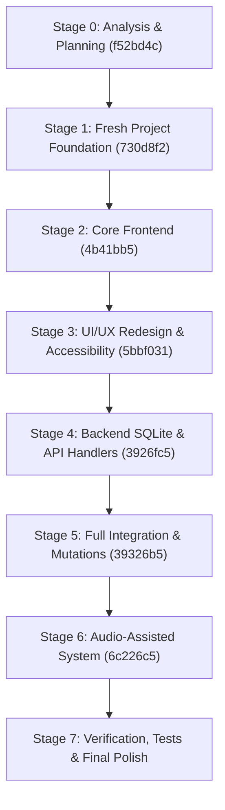

# SaharaCare MVP: Codefest Reconstruction Plan & Technical Audit

## 1. Codefest Hackathon Requirements & Context

Our hackathon organizing team, **Codefest**, has set strict requirements for project eligibility, evaluation, and progression:

- **Start from Scratch:** The application must be freshly initiated, cleanly scaffolded, and independently implemented. It must not be a superficial subset created by pruning the existing codebase.
- **Incremental Improvements:** Development must follow a clear, verifiable git commit history where each stage introduces small, cohesive, functional improvements.
- **Demonstrable Frontend Development:** Clear layout, intuitive navigation, accessible user flows, state handling (empty, loading, error, success).
- **Demonstrable Backend Development:** Server endpoints, relational data modeling, database persistence, CRUD workflows, server-side validation, error handling.
- **Demonstrable UI/UX Evolution:** Polished design system adhering to SaharaCare's palette (forest green, pale mint, crisp cards, accessible contrast, responsive layout).
- **Audio-Assisted System:** A first-class voice and speech accessibility subsystem designed for patients who are visually impaired, elderly, or have literacy challenges.
- **Staged Git Workflow:** Commits isolated on a dedicated development branch (`codefest/saharacare-mvp`), pushed incrementally, with `main` untouched until final review.

---

## 2. Audit of the Original SaharaCare Application

A thorough inspection of the original application at `c:\Users\ACER\Documents\Hackathon\saharacare` and documentation at `c:\Users\ACER\Downloads\Saharacare-official` revealed the following core architecture and scope:

### 2.1 Main Purpose & Problem Solved
- **Regional Context:** Nepal (`Asia/Kathmandu` timezone) & South Asia.
- **Problem Statement:** Elderly patients and chronic illness sufferers struggle to follow multi-time medication regimens, leading to non-adherence, adverse outcomes, and severe caregiver anxiety. Furthermore, text-heavy healthcare portals fail patients who have vision impairments or limited literacy.
- **Core Solution:** A bilingual (English & Nepali) medication adherence and family care platform featuring automated daily dosage timelines, real-time caregiver oversight, instant emergency dialers, and voice/audio assistance.

### 2.2 Original Architecture & Footprint
- **Framework:** Next.js 15 (App Router), React 19, TypeScript.
- **Database & Services:** Supabase (22 PostgreSQL migrations, Row Level Security, RPCs, Storage buckets, Realtime websocket channels).
- **External Integrations:** Google Gemini API (`@google/genai`), Web Push notifications (`web-push`), PDF generation (`pdf-lib`, `pdfjs-dist`).
- **Original Complexity:** Over 15,000 lines of code across 135+ files, heavy external service dependencies that require active Supabase cloud credentials, Gemini AI API keys, and internet connectivity.

---

## 3. Feature Inventory & MVP Scoping

To guarantee a completely reliable, self-contained, and demonstrable application during the Codefest hackathon, features were categorized into:

### Category 1: Essential MVP Features (Implemented)
1. **Patient Medication & Schedule Management:**
   - Add, edit, view, and toggle active medications with dosage details and instructions.
   - Schedule morning, afternoon, evening, and night timings.
2. **Today's Dose Timeline & State Machine:**
   - Materialize today's doses with states: `scheduled` -> `taken` (with timestamp) or `missed` / `late`.
   - Adherence calculation (Percentage of eligible doses taken on time).
3. **Audio-Assisted Accessibility System:**
   - **Text-to-Speech (TTS):** One-tap audible reading of today's medication timeline, dosage quantities, instructions, and adherence summary in clear synthesized speech (English and Nepali).
   - **Voice Input (STT):** Microphone-based voice search and symptom/note dictation with clear recording indicators and permission checks.
   - **Accessible Fallback:** Deterministic text fallback if the browser audio API is unavailable or denied.
4. **Caregiver Adherence Dashboard & Alerts:**
   - Real-time family overview of patient medication compliance.
   - Visual adherence progress ring and timeline of recent activity.
   - Alert feed for missed or delayed doses.
5. **Emergency Quick-Dial Shortcuts:**
   - Immediate access to Nepal emergency hotlines: Ambulance (`102`), Police (`100`), Red Cross (`01-4270650`).
6. **Bilingual Support (English & Nepali):**
   - Seamless one-click language toggle across UI labels, notifications, and audio read-aloud language settings.

### Category 2: Important Features (Fast-Follow Post-MVP)
- Multi-user authentication session persistence with Supabase Auth or Auth0.
- 9-step client-side Medical KYC Questionnaire with PDF export.
- Doctor appointment slot reservation engine.

### Category 3: Advanced Features (Excluded from Hackathon MVP)
- 22 Supabase SQL migration files with complex RLS triggers (replaced with clean local SQLite).
- Remote storage bucket signed URLs and cron-driven physical deletion.
- Web Push Service Worker background push subscriptions.
- Paid AI cloud integrations that require external API keys or risk network timeouts during live demos.

---

## 4. Technology Stack Selection for SaharaCare MVP

| Layer | Selected Technology | Justification |
| :--- | :--- | :--- |
| **Framework** | Next.js 15 (App Router) + React 19 | Standard modern React foundation matching the original design semantics with server components and API routes. |
| **Language** | TypeScript 5.7+ (Strict Mode) | Type safety across API contracts, domain entities, and component props. |
| **Styling** | Tailwind CSS 3.4 | Rapid implementation of the SaharaCare design system (forest green `#083430`, teal `#17615A`, pale mint `#EAF6F4`). |
| **Icons** | Lucide React | Lightweight, consistent iconography matching original design. |
| **Backend & Persistence** | Built-in `node:sqlite` (Node.js 24 native SQLite) | Zero external dependencies, no native C++ rebuild issues, persistent file storage at `data/saharacare.db`, atomic transactions, full SQL capabilities. |
| **Audio System** | Web Speech API (`SpeechSynthesis` & `SpeechRecognition`) | Native browser integration for zero-latency speech synthesis and voice recognition with zero third-party cloud costs. |
| **Testing** | Node.js Native Test Runner (`node --test`) | Fast, built-in test runner validating schemas, API routes, calculation logic, and adherence formulas without heavyweight test harness overhead. |

---

## 5. Development Milestone Roadmap (Stages 0 to 7)

---

## 6. Codefest Compliance Verification

- **Independent Rebuild:** All files are newly authored in this workspace (`C:\Users\ACER\Documents\Saharacare`). The original app remains intact at `..\Hackathon\saharacare`.
- **Git Discipline:** Local commits created per stage on `codefest/saharacare-mvp` branch; `main` is kept untouched at its initial setup commit until explicit user approval for merge.
- **Functional Guarantee:** The application runs entirely offline with `npm run dev` and `npm test` without requiring external cloud accounts or paid API tokens.
